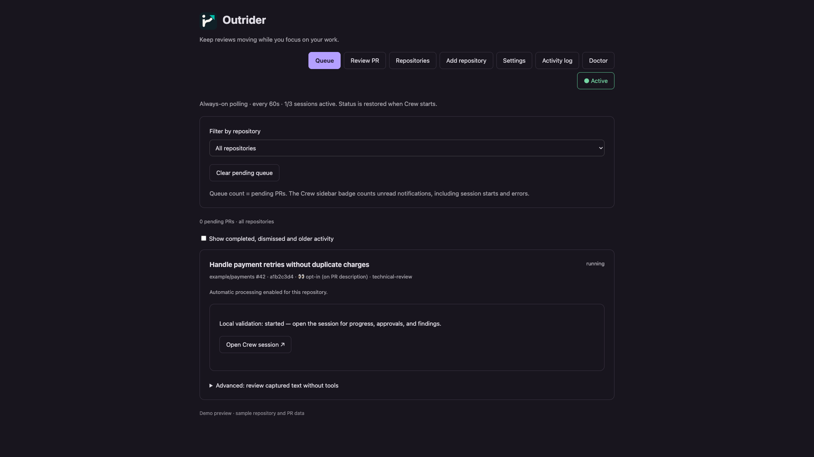

# Keep up with PRs. Keep your focus.

AI helps teams write more code, faster. Reviewing it and keeping up with the
feedback still takes work. **Outrider brings that work into Kiro Crew:** it watches
GitHub, spots PR activity that needs attention, and can automatically start a
review session in the right Crew folder.

Put a 👀 on a PR, let your chosen Crew member investigate, and come back to
findings, test results, and questions worth your attention. For your own PRs,
Outrider can start sessions to help work through incoming review feedback.

## Less chasing. More reviewing.

- **Stay ahead of incoming work.** Watch your own PRs, mentions, review replies,
  and PRs you opt into with a reaction. Relevant activity becomes a work queue.
- **Review where you already work.** Use your existing Crew folders and local
  checkouts. Follow each review through its linked Crew session.
- **Go beyond a diff summary.** Local sessions can inspect the repository and run
  focused checks in isolated worktrees, using your reviewer and Crew permissions.
- **Make good reviews repeatable.** Give each repository its own triggers and
  ordered workflows, from a technical review to a final CI check.
- **Keep your own PRs moving.** Give a session the feedback and ownership context
  it needs to help prepare the next change.
- **Stay in charge.** Choose automatic or manual starts, limit concurrent
  sessions, and configure reviewer and trust defaults with per-repository overrides.

Outrider starts the work; you make the decisions. Review findings can be incomplete
or wrong. Check the evidence before acting. Outrider does not automatically merge
PRs. Pushes and posts depend on your task policies and Crew's permissions.

## Get started

Outrider runs a Python backend and an MCP server on the machine running Crew.
Enable third-party app execution in **Settings → Security → Third-party apps**
before enabling Outrider. This is Crew's `agent.apps_allow_third_party` setting;
without the grant, Crew can report `app_execution_denied`. Outrider does not change
this security setting for you.

Open Outrider in Crew and follow the setup wizard:

1. **Check readiness.** Doctor checks Outrider, Git, and GitHub CLI authentication.
   A compatible host Outrider is reused. Published plugin builds with pinned
   runtime releases can download a verified private copy when none is installed.
   An incompatible host version requires an explicit choice; it is never replaced.
2. **Choose a Crew folder.** Outrider suggests its GitHub repository. For a fork,
   it prefers `upstream` for watching PRs and keeps the local checkout for reviews.
   You can also use a repository without a folder as a manual queue.
3. **Bring your preferences.** Use defaults or preview your existing CLI config.
   Supported task settings are imported; Crew keeps control of session settings.
4. **Choose how reviews start.** Set automatic sessions, reviewer, trust, and
   concurrency. Finish to save and start polling.

Wizard progress is saved when moving between steps. Existing installations keep
opening the queue; **Doctor** remains available for troubleshooting. Add more
repositories with **Add repository**, then customize them under **Repositories**.
Global defaults live in **Settings**. To try the onboarding screens on an existing
installation, open **Doctor → Preview setup wizard**. Preview does not save
settings, install a runtime, start polling, or launch sessions.

Git and authenticated [GitHub CLI](https://cli.github.com/) are required on the
machine running Crew. Doctor explains what is missing. Run `gh auth login` there
if needed. Outrider does not install these tools or handle your credentials.

### Development installation

Until a compatible runtime release is published and pinned, run `task install`
from this repository, then install `apps/kiro-crew` through Crew's local app
installer. This development build intentionally does not download an arbitrary
or incompatible release. Use Crew 0.9.0 or later and accept its app permission
request. [Release preparation](release/README.md) describes the marketplace gates.

The plugin targets macOS, Linux, and Windows. Automated tests cover the backend
and UI contracts; a fresh-profile live Crew check is still required per platform
before claiming end-to-end release validation.

## Review a PR right now

Choose **Review PR**, paste `https://github.com/owner/repo/pull/123`, and submit.
The repository must already have a Crew folder and matching remote configured.
Outrider captures current context and requests a local session, even if automatic
sessions are off. Manual requests use matching `opt_in` workflows without adding
a GitHub reaction or changing your subscriptions. The usual ownership rules,
reviewer, trust, and session limit apply.

An active session for the PR prevents a duplicate. Repeating an unchanged manual
capture reuses its queue item; completed or failed work remains linked for explicit
inspection/retry. If the session limit is reached, the item stays queued; start it
from the queue when capacity is available (automatic scheduling still follows your
configured rules). Preparation errors appear in the Review PR view and activity log.

## How the queue works

Polling continues while Outrider is active and resumes after Crew restarts.
**Active / Inactive** controls polling and new automatic sessions; running sessions
remain managed by Crew. Use the repository filter, open linked sessions, dismiss
items, or clear pending work without deleting active work or history.

Automatic sessions apply to new activity after enabling them. Existing backlog
can be started manually. Outrider limits concurrency and prevents simultaneous
sessions for the same PR. Closed or deleted incomplete sessions release capacity
and require an explicit retry. Uncertain dispatches are not silently repeated.

The sidebar badge counts unread Crew notifications, including starts and errors;
the queue count represents pending PRs. Details are available in **Activity log**.

## Your checkout, your workflow

Local reviews use an isolated worktree under the selected checkout's
`.claude/worktrees`. The original checkout and its uncommitted changes are kept.
Outrider checks that the selected remote matches the watched repository and that
the PR head is still current before launching.

Sessions receive PR metadata, trigger and comment scope, ownership rules, and the
selected workflow's ordered steps. Your own PRs and other people's PRs can have
different policies. Explicitly configured review forks can receive permitted
review evidence; the original PR is not treated as your own branch.

Crew controls the model, tools, reviewer, and approvals. CLI execution settings
such as `agent`, `mode`, sandbox, and launcher are not imported or silently mapped
to trust. Task policies such as `push`, `github_writes`, and `others_prs` remain
part of the prompt; they do not install the CLI's tool guards or native dialogs.

**Review without tools** is an optional, limited review of captured context. It
cannot inspect the checkout or run tests. Its fixed reviewer policy blocks tools;
truncated captures are marked. Use local sessions for repository validation.

## Bring an existing Outrider configuration

In **Repositories → Import CLI configuration**, load the default config, select a
file, or paste YAML. The preview shows effective repository settings, retained
own/other-PR differences, removed execution settings, and global polling settings.
Apply the preview and save to make changes. Importing never rewrites your CLI file.

Default config loading is explicit and follows the CLI's configuration discovery.
Normal polling and MCP use only the app's own config and state. Runtime lookup is
`OUTRIDER_BIN` when set, otherwise compatible host installations, then the private
runtime. Nothing changes your system `PATH` or replaces your standalone binary.

Form and YAML views edit the same settings: triggers, reactions, workflows,
prompts, ignored authors, and launch checks. Switching to Form reformats YAML and
removes comments. AI-assisted setup creates a validated draft for you to review
and save; it does not apply changes automatically.

## MCP and privacy

The app exposes these four read-only MCP tools, alongside the setup tools below: `list_repositories`,
`configuration_schema`, `list_reviews`, and `propose_repository_config`. The
portable Go MCP server receives explicit app config and state paths. It does not
load host CLI configuration. Registering a repository can start reviews if your existing automatic-session defaults enable them. [Use MCP with other clients](../../docs/mcp.md).

PR context is stored locally in the app data directory and sent to your configured
Crew model when a review starts. GitHub notifications remain unread. Backend
UI requests require Crew's signature; MCP setup requests use a separate local credential restricted to setup routes. Findings render as text. For existing personal
chats, copy findings and paste them yourself; direct transcript writes are limited
to app-owned chats.

Windows queue storage flushes files but cannot guarantee directory durability
after power loss. A crashed scan can leave `inbox/scan.lock`; stop any remaining
scan before removing that lock. Doctor never removes it automatically.

## App preview

This preview renders the app's queue components with sample repository and PR
data; it contains no private queue information.

## Development and support

Run `task crew:test` for backend and UI contract tests, and `task test` for Go.
There is no frontend build step. Update installed copies through Crew's app update
flow so code, agent definitions, and permissions stay in sync.

[Source](https://github.com/appetizers-io/outrider) ·
[Report a problem or suggest an improvement](https://github.com/appetizers-io/outrider/issues)

### Add a project from a Crew conversation

Ask **“Add this project to Outrider.”** The MCP setup tools discover Crew folders,
inspect their checkouts and remotes, then register the repository through the
running app. Ambiguous projects require a choice. Existing registrations and
session preferences are preserved; new repositories inherit your polling and
automatic-session defaults. Reload the app's MCP server after updating the plugin to expose the new tools.
No new CLI capability or binary upgrade is required: these tools live entirely
in the Crew app. The adapter forwards the existing read-only protocol traffic
to the portable MCP server and handles Crew setup calls itself.
